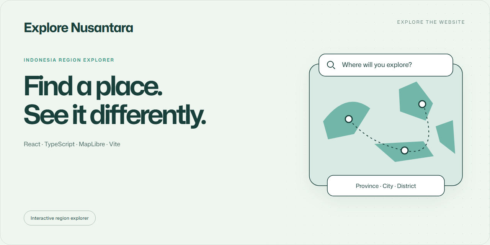

<a href="https://explore-nusantara-indonesia.vercel.app"></a>

# Explore Nusantara

Explore Indonesian regions through searchable filters, an interactive 3D map and credited local photography.

**React · TypeScript · MapLibre · Vite** · Interactive region explorer

<table><tr><td>

### Open the website

**[explore-nusantara-indonesia.vercel.app](https://explore-nusantara-indonesia.vercel.app)**

The public demo is available in your browser. Scan the QR to open it on another device.

</td><td align="center" width="220"><a href="https://explore-nusantara-indonesia.vercel.app"></a><br><sub>Direct website link</sub></td></tr></table>

## Explore by place

- Search provinces, regencies/cities and districts with keyboard-friendly filters.
- Share a selection through URL search parameters.
- Switch between 2D and terrain views and fly to the selected place.
- Browse local photographs and nearby Wikimedia Commons images with source credits.
- Keep using filters and local photos if the map or photo service is unavailable.

## Run locally

Use **Node.js 24**.

```sh
git clone https://github.com/EGYYFZA/Explore-nusantara.git
cd Explore-nusantara
npm ci
npm run dev
```

Open the URL printed by Vite, usually **http://localhost:5173**.

```sh
npm run lint
npm test
npm run build
```

## Data and map notes

The local dataset contains 38 provinces, 514 regencies/cities and 7,285 districts.
It comes from [nekoding/wilayah-indonesia](https://github.com/nekoding/wilayah-indonesia),
with pinned [import provenance](public/data/regions-source.json) and its
[MIT notice](public/data/licenses/wilayah-indonesia-MIT.txt).

The map uses OpenFreeMap/OpenStreetMap and Mapzen terrain. Internet access and
WebGL are required for map rendering; no API key or location permission is needed.
Representative points are not administrative boundaries. Nearby-photo searches
cover a 10 km radius around the selected point and may return no results.

## Photography

The collection includes 126 local Wikimedia Commons images. Author, license and
source links appear in the viewer and [photo credits](docs/photo-credits.md).
Review those terms before reusing individual photographs. See [SECURITY.md](SECURITY.md).
